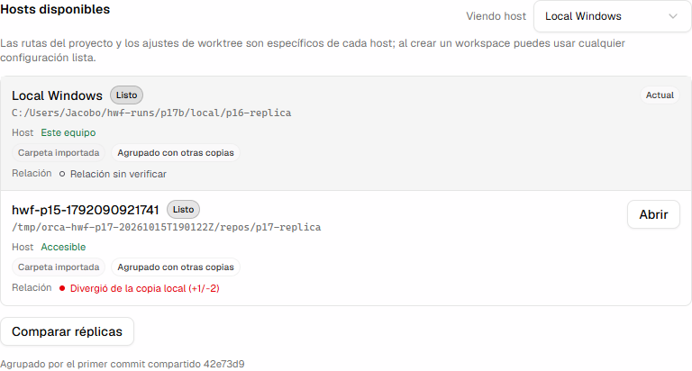
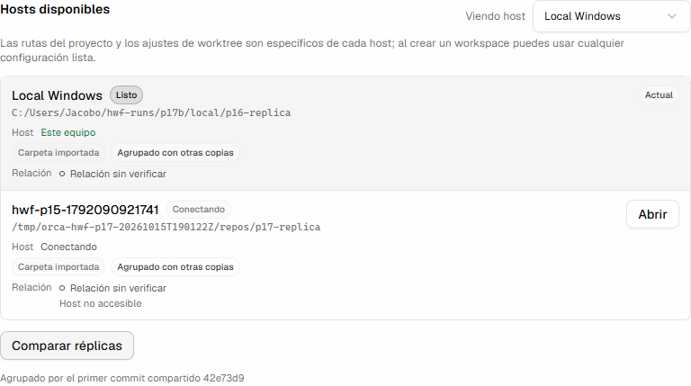

# Live rendered Settings relation 2026-10-15: row 62

## Plane

REAL-TWO-HOST + LOCAL_RENDER. The Electron app (e2e build) on the desktop PC, Spanish UI, driven by
Playwright through `orcaPage`, connected over a real `ssh -L` carrier to a GEX44 disposable phase-17
root. The local replica is a remote-less repo made by `seed-local-p16`; the remote one is `seed-p17`
(two commits past the shared seed root). Every value is read from the rendered row's
`data-replica-relation*` handles; the screenshots are what a user sees.

## Command

```
npx playwright test tests/e2e/hwf-two-host-replica-settings-relation.spec.ts \
  --config tests/playwright.config.ts --project=electron-headless --workers=1
```

with `SKIP_BUILD=1`, `ORCA_HWF_TWO_HOST=1`, `ORCA_HWF_RUN_FILE` (run-file `--seed --local-seed`),
`ORCA_HWF_P17_PATH`, `ORCA_HWF_LOCAL_PORT=61013`, optional `ORCA_HWF_SCREENSHOT_DIR`.

## Result

Three passing runs. Lines from the last one (`/tmp/orca-hwf-p17-20261015T190122Z`, build with the footer
fix):

```
HWF62_BEFORE {"state":"unverified","tone":"unknown","text":"Relación sin verificar","detail":"Aún no se ha comparado"}
HWF62_LIVE {"state":"diverged","tone":"critical","text":"Divergió de la copia local (+1/-2)","detail":null}
HWF62_LIVE PASS
HWF62_DOWN {"state":"unverified","tone":"unknown","text":"Relación sin verificar","detail":"Host no accesible"}
HWF62_DOWN PASS
  1 passed (1.1m)
```

Before any comparison the row reads unverified with its reason, never healthy. A real click on
"Comparar réplicas" publishes `diverged` with both measured counts in the critical tone. With the carrier
killed, a second Compare publishes `unverified` with the closed reason "Host no accesible" in the unknown
tone (hollow dot), and the host chip reads "Conectando". Teardown `REMAINING=0`, `PROC_COUNT=0`.





## Found on the screenshots and fixed

The first two runs showed the section footer reading "Agrupado por el primer commit compartido b642d1f.
Relación aún sin verificar" while the row already showed `diverged`: `describeGroupingEvidence`
(`src/renderer/src/components/settings/replica-topology-presentation.ts`) appended the relation clause
unconditionally, from before the pair service published relations. The footer now states only what
grouped the copies ("Agrupado por el primer commit compartido 42e73d9" above); each row owns its
relation. `ReplicaTopologyDetails.test.tsx` pins the footer text (red before the fix).

## Not covered

- The anchor row (Local Windows) reads "Relación sin verificar": the anchor has no relation to itself
  published (phase 2 risk, unchanged). It reads unknown, not healthy.
- ja, ko and zh strings are executor-authored, not native-reviewed.
- One pair shape (diverged); same / ahead / behind / unrelated are covered hermetically only.
